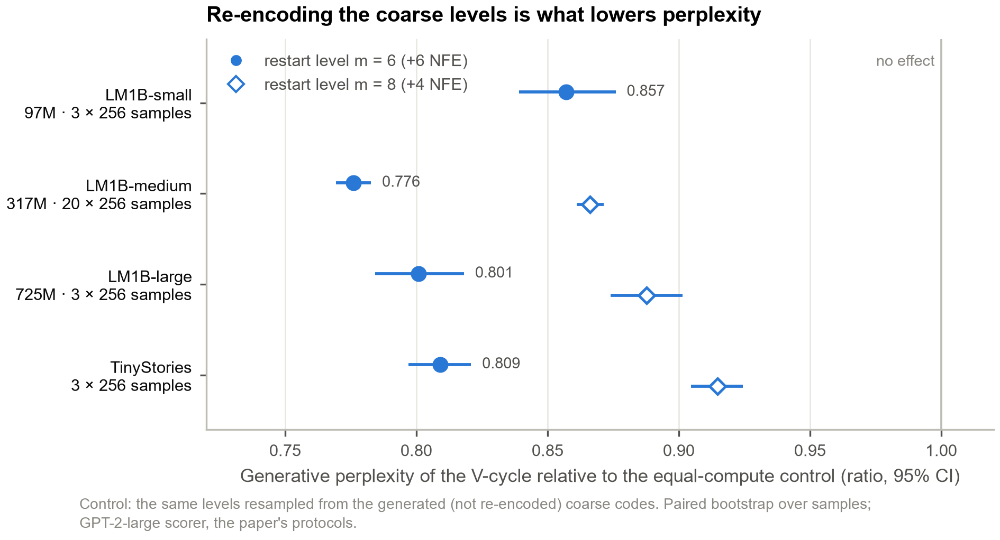
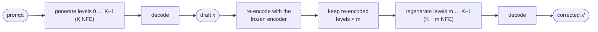
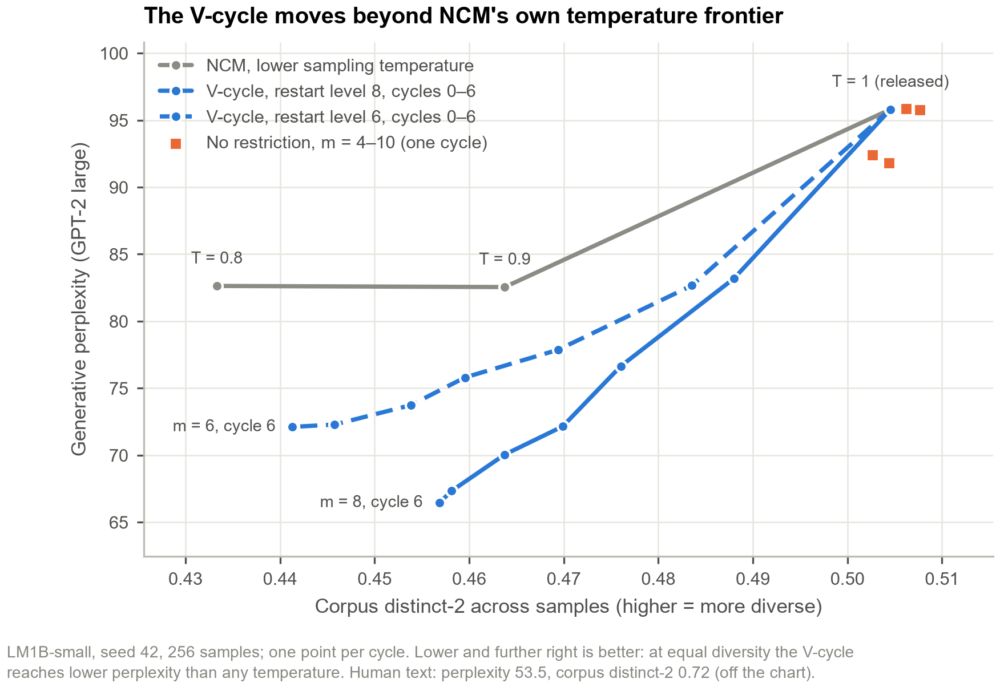
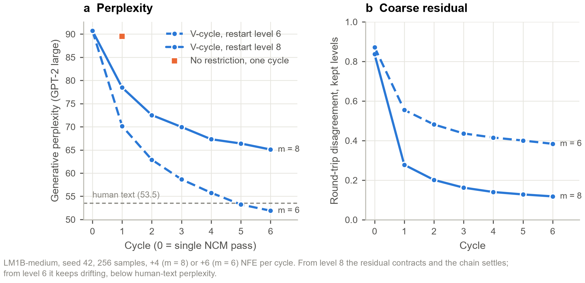
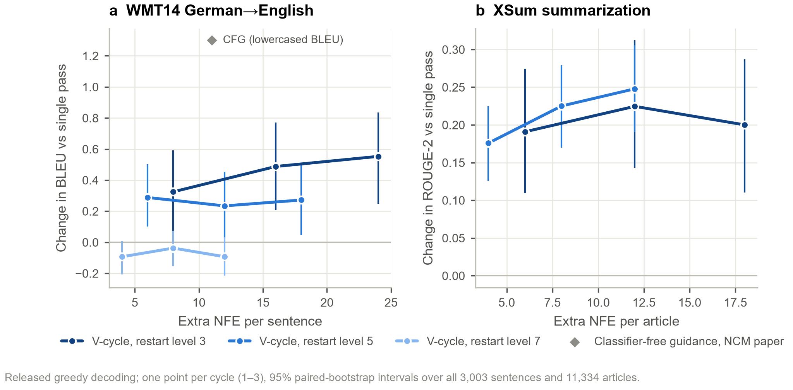
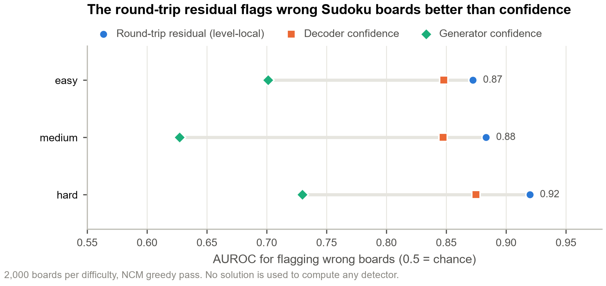
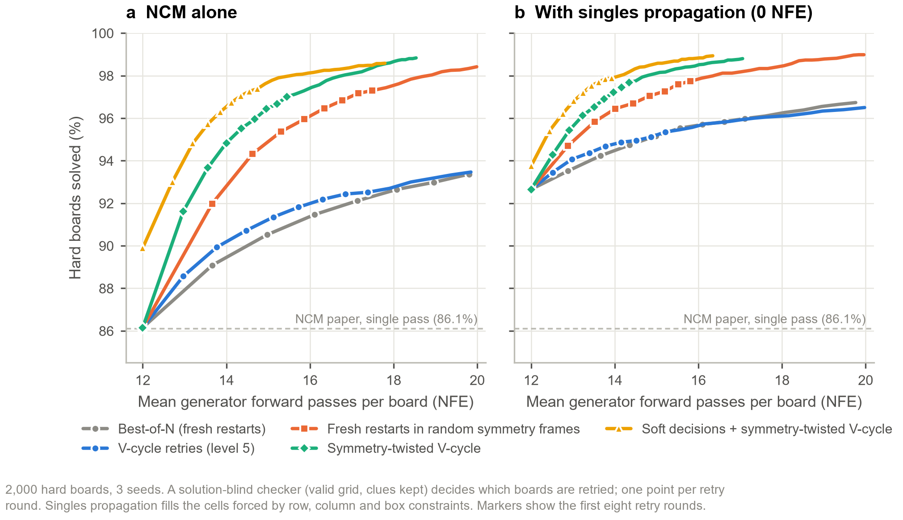

# Multigrid V-Cycle Decoding for Next-Concept Models

Training-free correction cycles for the released checkpoints of Next-Concept Modeling (NCM; Kumbong, Khare
*et al.*, 2026, [arXiv:2610.14162](https://arxiv.org/abs/2610.14162); code:
[HazyResearch/ncm](https://github.com/HazyResearch/ncm)).

## Summary

NCM generates a sequence as a hierarchy of discrete codes, from coarse to fine, in a single pass of one generator
evaluation per level. A multigrid solver would follow such a pass with a *restriction*: project the fine solution back
onto the coarse grids and correct. This repository adds that step to NCM at inference time. The decoded output is
re-encoded with the frozen tokenizer, its coarse codes replace the generated ones, and the fine levels are regenerated.
No parameter is trained.

The main findings are:

1. **Unconditional text.** One V-cycle from level 6 (+6 generator evaluations, NFE) lowers generative perplexity by
   14–22% on all three released LM1B models and on TinyStories, relative to an equal-compute control that regenerates
   the same levels without re-encoding (Fig. 1). A scorer from another model family, MAUVE at 5,120 samples and an
   LLM judge agree.
2. **Mechanism.** 86–100% of the generator's coarse codes differ from the codes the encoder assigns to the text they
   decode to, and the equal-compute control shows that replacing them with the re-encoded codes carries the effect.
   This is consistent with a training-free correction of exposure bias but does not prove it: how much a sample's
   coarse codes change predicts its gain only weakly (Spearman ρ ≤ 0.04 on LM1B, 0.18 on TinyStories; Section 3.4).
3. **Error detection.** The amount of round-trip disagreement detects wrong Sudoku boards with an AUROC of 0.92
   (decoder confidence: 0.87), without access to the solution.
4. **Sudoku.** Retrying rejected boards in a random symmetry frame of the puzzle and feeding posterior-mean code
   embeddings raises hard-Sudoku accuracy from 86.2% (single pass) to 96.5% at a mean of 14 NFE with NCM alone,
   and to 97.9% with rule-based singles propagation; V-cycle retries in a fixed frame reach 90.2% and 94.8%.
5. **Limits.** On WMT14 and XSum the V-cycle yields a small, significant improvement (+0.55 BLEU, +0.25 ROUGE-2). On
   WMT14 it is smaller than the paper's classifier-free guidance, which also costs less (+1.3 BLEU for +11 NFE, against
   +0.56 for +24 NFE; lowercased). Zero-compute alternatives on text, including error diffusion within a level, gave no
   measurable gain (Section 4).



**Figure 1.** Generative perplexity of one V-cycle relative to the equal-compute control, for every released LM1B model
and TinyStories. The control regenerates the same levels from the generated (not re-encoded) coarse codes.

## Contents

1. [Method](#1-method)
2. [Experimental protocol](#2-experimental-protocol)
3. [Results](#3-results)
4. [Negative results](#4-negative-results)
5. [Related work](#5-related-work)
6. [Limitations](#6-limitations)
7. [Reproduction](#7-reproduction)
8. [Repository layout](#8-repository-layout)
9. [References](#9-references)
10. [License](#10-license)

## 1. Method

### 1.1 Next-Concept Modeling

A frozen multiscale residual VQ-VAE maps a token sequence $x$ to codes $r = (r_0, \dots, r_{K-1})$ on $K = 12$
levels. Level $k$ quantizes, with its own codebook, the residual left by levels $0, \dots, k-1$ at a resolution of
$n_k$ positions (for Sudoku, $n_k = 1, 2, 4, \dots, 89$). A transformer generator predicts all codes of level $k$ in
parallel, conditioned on the cumulative reconstruction $\hat z^{(k-1)}$ of the coarser levels; codes within a level are
conditionally independent. A pass costs one generator evaluation per level, and the tokenizer's decoder maps
$\hat z^{(K-1)}$ to tokens.

### 1.2 The V-cycle



1. Decode the sample $r$ to tokens $x$.
2. *Restriction:* re-encode $x$ with the frozen encoder and quantizer, $r' = E(x)$.
3. *Coarse correction:* keep $r'_k$ for the levels $k < m$.
4. *Prolongation:* regenerate the levels $m, \dots, K-1$ with the generator, conditioned on $r'_{<m}$, and decode.

The cycle costs $K - m$ NFE and can be iterated. The per-level disagreement between $r$ and $r'$ is the *residual*. The
*level-local* residual compares $r_k$ with the code the quantizer would choose given the *generated* coarser levels, so
that a single disagreement does not cascade to all finer levels.

### 1.3 Correspondence with multigrid

| Multigrid | NCM | Code |
|---|---|---|
| Coarse grid | code levels $k = 0, \dots, K-1$ | `LevelDecoder.levels` |
| Prolongation | generation of levels $m, \dots, K-1$ given $\hat z^{(m-1)}$ | `LevelDecoder.run(prefix, start=m, codes=...)` |
| Restriction | re-encoding with the frozen encoder and quantizer | `LevelDecoder.encode` |
| Residual | per-level disagreement between $r_k$ and $r'_k$ | `vcycle.vcycle.disagreement` |
| Level-local residual | disagreement given the generated coarser levels | `LevelDecoder.encode_given_coarse` |
| V-cycle | decode → re-encode → keep $r'_{<m}$ → regenerate → decode | `vcycle.vcycle.cycle` |

## 2. Experimental protocol

- **Checkpoints and decoding.** All released checkpoints are used unchanged. `LevelDecoder` reproduces
  `NextConceptTransformer.generate` code for code under a fixed seed, on CPU and GPU, for every model used here.
  Sampling follows the released evaluation scripts: on LM1B, level 0 is drawn from the released unigram, levels are
  sampled at temperature 1 and tokens are picked with the released frequency and adjacency penalties; XSum and WMT14
  are decoded greedily (`top_k: 1`); Sudoku uses the greedy pass.
- **Metrics.** Generative perplexity under GPT-2 large with the paper's protocols (FLM for LM1B; genppl, with samples
  cut at the first EOS, for TinyStories); a second scorer from another model family (Qwen2.5-1.5B); MAUVE against
  held-out LM1B validation text; per-sample unigram entropy and corpus-level distinct-$n$; sacreBLEU and chrF (WMT14),
  ROUGE-1/2/L (XSum); the share of Sudoku boards solved exactly.
- **Controls.** *No restriction* regenerates the same levels from the generated coarse codes and costs the same as the
  V-cycle. Under greedy decoding it reproduces the single pass exactly, so the single pass is the control on XSum and
  WMT14. On Sudoku, every method is compared at a matched mean number of NFE per board.
- **Compute.** NFE counts generator forward passes. Because coarse levels are short, NFE overstates the cost of
  revisiting them; Sudoku comparisons are therefore also reported at matched FLOPs, approximated by the number of token
  positions processed (prompt plus sampled levels; one full pass = 1).
- **Statistics.** 95% confidence intervals are paired bootstrap intervals (1,000 resamples unless stated) over samples,
  documents or boards, with seeds pooled. Perplexity effects are reported as ratios of corpus perplexities.
- **Hardware.** Sudoku phases 0–3 and the first LM1B runs used four CPU cores; later runs used a 6 GB RTX 4050 laptop
  GPU and, for the LLM judge, the error-diffusion sweep and one replication, an NVIDIA A10G. GPU scoring reproduces the CPU per-sample
  negative log-likelihood to 4 × 10⁻⁷.

## 3. Results

### 3.1 Reproduction

| Quantity | This repository | NCM paper |
|---|---|---|
| Sudoku solved, easy / medium / hard (greedy, 2,000 boards each) | 99.4 / 96.4 / 86.3% (CPU); hard 86.15% (GPU) | hard 86.1% |
| LM1B-small gen. PPL, three seeds; entropy | 95.8 / 94.6 / 91.0; 4.32 | about 92; 4.31 |

The CPU and GPU greedy passes differ on near-ties (0.1–1.4% of hard boards, logit margins below 10⁻⁵).

### 3.2 Unconditional text

**Table 1.** Generative perplexity (GPT-2 large) after one cycle from level $m$, against the equal-compute control.
Ratios are paired bootstraps over the pooled samples.

| Model | Samples | Single pass | No restriction, $m = 6$ | **V-cycle, $m = 6$** | V-cycle / no restriction, $m = 6$ | V-cycle / no restriction, $m = 8$ |
|---|---|---|---|---|---|---|
| LM1B-small (97M) | 3 × 256 | 93.8 | 93.2 | **79.9** | **0.857** [0.839, 0.876] | – |
| LM1B-medium (317M) | 20 × 256 | 88.8 | 88.4 | **68.6** | **0.776** [0.769, 0.783] | 0.866 [0.861, 0.871] |
| LM1B-large (725M) | 3 × 256 | 82.2 | 79.8 | **63.9** | **0.801** [0.784, 0.818] | 0.888 [0.874, 0.901] |
| TinyStories | 3 × 256 | 16.4 | 16.5 | **13.3** | **0.809** [0.797, 0.821] | 0.915 [0.905, 0.924] |

- **The re-encoding step carries the effect.** The control changes perplexity by at most 3%; the V-cycle lowers it by
  14–22%. On LM1B-medium the V-cycle is better on all 20 seeds, and medium with one cycle (68.6; 1.55 passes) is
  better than the 2.3× larger model's single pass (82.2).
- **The restart level matters.** Every restart level from 4 to 10 helps (ratios 0.93, 0.87, 0.87 and 0.92 on
  LM1B-small), whereas a restart from level 3 has no significant effect (0.985 [0.950, 1.020]): it regenerates levels
  3–5 off the encoder's manifold again.
- **Entropy is unchanged or slightly higher** in every row; corpus distinct-2 falls by 4–6% (Section 3.4).
- **The edits are local.** The V-cycle keeps the draft's content and repairs fluency. On TinyStories,
  *"Once upon a time there made a little girl … so sad and and scared … said "ooIs?""* becomes
  *"… there was a little girl … so sad and scared … said "What happened?""*. Regenerating from the generated coarse
  codes produces an unrelated text instead.

### 3.3 Is lower perplexity better text?

**Table 2.** Four quality measures that do not rely on GPT-2 perplexity (LM1B-medium, 20 seeds, 5,120 samples per
variant).

| Text | GPT-2 gen. PPL | Qwen2.5-1.5B gen. PPL | MAUVE vs. human text ↑ |
|---|---|---|---|
| Human (held-out LM1B validation) | 53.5 | 40.8 | – |
| NCM single pass | 88.8 | 105.9 | 0.312 |
| No restriction, $m = 6$ | 88.4 | 105.6 | 0.307 |
| **V-cycle, $m = 6$** | **68.6** | **76.4** | **0.410** |
| V-cycle, $m = 8$ | 76.8 | 88.8 | – |

| Pairwise LLM judge (Qwen2.5-7B-Instruct, both orders, 5,120 pairs) | Mean preference for A [95% CI] | Pairs preferring A |
|---|---|---|
| Sanity check: human text (A) vs. NCM single pass | 0.669 [0.664, 0.674] | 97% |
| **V-cycle, $m = 6$ (A) vs. no restriction, $m = 6$** | **0.589** [0.581, 0.597] | **64%** |
| **V-cycle, $m = 6$ (A) vs. single pass** | **0.633** [0.626, 0.639] | **76%** |

- **A second scorer agrees, more strongly:** the Qwen ratio against the control is 0.724 [0.717, 0.730] at $m = 6$
  and 0.837 [0.832, 0.843] at $m = 8$.
- **MAUVE agrees and is significant at this sample size.** Over 20 rounds of paired half-size subsamples, the V-cycle
  leads the control by +0.077 [+0.024, +0.130] and is ahead in every round. At 768 samples the same comparison was not
  resolvable. Absolute MAUVE decreases with the number of samples, so only differences are comparable.
- **The judge agrees.** Its strong position bias (it prefers the second text in 56–82% of LM1B pairs) is removed by
  averaging over both orders.
- **No over-smoothing after one cycle.** The V-cycle closes 51% of the log-perplexity gap between NCM and human text
  and stays above human perplexity.

### 3.4 Quality, diversity and iteration



**Figure 2.** Perplexity against corpus diversity on LM1B-small. Lowering NCM's sampling temperature traces its own
frontier (grey); V-cycles lie beyond it: at equal corpus distinct-2 (0.464), four cycles from level 8 reach a
perplexity of 70.0, against 82.5 at temperature 0.9.



**Figure 3.** Iterated V-cycles on LM1B-medium. (a) Perplexity per cycle. (b) Round-trip disagreement on the kept
levels, which contracts every cycle, as in a convergent multigrid iteration.

- **No exact fixed point, but a contracting residual.** No sample ever round-trips exactly, yet the disagreement on the
  kept levels shrinks towards a floor.
- **The restart level selects the regime.** From level 8 the chain settles: successive cycles agree on 95% of tokens,
  73% of the draft survives six cycles, and corpus diversity falls by 6%. From level 6 it keeps moving: after six
  cycles the text shares little with the draft (27% token agreement), diversity falls by 13% and perplexity (51.9)
  drops *below* that of human text (53.5). A single cycle is the safe default.
- **Gating does not pay on text.** Cycling only the samples with the largest level-local residual beats a random
  choice by 1.5–2% at equal compute on LM1B-small and TinyStories and not significantly on LM1B-medium; the V-cycle
  improves nearly every sample.
- **The gain barely grows with the residual.** If the gain came from replacing off-manifold coarse codes, samples whose
  kept levels change more on the round trip should gain more over the control. On LM1B they hardly do: Spearman
  ρ = +0.04 [+0.01, +0.06] on LM1B-medium (5,120 samples), +0.03 on large and about zero on small (both intervals
  include zero). TinyStories shows a weak trend (ρ = +0.18 [+0.10, +0.25]; ratio 0.86 in the lowest residual quintile,
  0.76 in the highest). Every sample is far off the manifold (10th–90th percentile of the round-trip disagreement:
  0.69–0.97 across models), so this may be saturation. An intervention that re-encodes only part of the coarse codes
  would separate the two; it was not run.

### 3.5 Prompted tasks

**Table 3.** Change against the released single pass after one to three greedy cycles. Restriction re-encodes the
output in canonical form (text, EOS, then padding); re-encoding the raw output ids instead costs 4.3 BLEU on WMT14.

| Task (single pass) | Restart level (NFE per cycle) | Change after 1 / 2 / 3 cycles [95% CI] |
|---|---|---|
| WMT14 de→en, 3,003 sentences (BLEU 21.73) | 3 (+8) | +0.32 [+0.05, +0.59] / +0.49 [+0.21, +0.77] / **+0.55** [+0.25, +0.83] |
| | 5 (+6) | +0.29 [+0.10, +0.50] / +0.23 [+0.02, +0.45] / +0.27 [+0.05, +0.51] |
| | 7 (+4) | −0.09 [−0.21, +0.01] / −0.04 / −0.09 |
| XSum, 11,334 articles (ROUGE-2 12.71) | 5 (+4) | +0.18 / +0.22 / **+0.25** [+0.19, +0.31] |
| | 3 (+6) | +0.19 / +0.22 / +0.20 |



**Figure 4.** Gains on the prompted tasks against extra compute. The grey diamond is the paper's classifier-free
guidance on WMT14 (lowercased BLEU; our lowercased and cased gains agree to 0.01).

- **A small polish.** After three cycles from level 5, XSum ROUGE-1/2/L improve by +0.24/+0.25/+0.19 and GPT-2
  perplexity falls by 24%, with unchanged summary length. Under greedy decoding a cycle is a deterministic map, and
  47% of summaries reach an exact fixed point by the third cycle.
- **Readers barely notice:** the LLM judge's mean preference is 0.526 [0.516, 0.535] on XSum and 0.515
  [0.506, 0.525] on WMT14.
- **Guidance is the stronger lever on translation.** The paper's classifier-free guidance gains +1.3 BLEU for +11 NFE;
  the best V-cycle gains +0.56 (lowercased) for +24 NFE.

### 3.6 The round-trip residual as an error detector

A sample is a fixed point if $E(D(r)) = r$. **No NCM sample is a fixed point** (0% of 6,000 Sudoku boards, of the LM1B
and TinyStories samples, and of 14,337 XSum and WMT14 outputs), although $D(E(x)) = x$ holds for every Sudoku solution:
the generator writes a non-canonical code for the board it means. The amount of disagreement nevertheless carries
signal.



**Figure 5.** AUROC for flagging wrong Sudoku boards (2,000 boards per difficulty).

- **On Sudoku the residual beats confidence** at every difficulty (hard: 0.92 against 0.87 for decoder confidence and
  0.73 for generator confidence), and it localizes errors: at level 4, where the generator is fully confident on every
  board, a span on which the residual fires contains a wrong cell in 97.5% of cases (base rate 43%).
- **On text it is weaker.** It flags the worst-perplexity tenth of samples with AUROC 0.63–0.74 on LM1B and 0.81 on
  TinyStories, and barely at all on the prompted tasks (0.51–0.63), where a bad output is mostly a wrong choice of
  content.

### 3.7 Sudoku: correction at matched compute

A solution-blind checker (a valid grid that keeps every clue) decides which boards are retried; it accepted no wrong
board in any run. Every method starts from one 12-NFE pass.

**Fixed frame (phase 3, CPU, 3 seeds × 2,000 hard boards).** V-cycle retries from level 5 beat best-of-N restarts by
+1.2 points at 14 NFE (90.4% against 89.3%; [+0.6, +1.7]). Most of this gain comes from keeping the coarse levels: the
re-encoding step adds +0.3 to +0.5 points, with an interval that includes zero, because Sudoku's generated codes are
mostly on the encoder's manifold (0–20% disagreement per level on solved boards). Resampling only the disagreeing
positions (masked resampling) is significantly worse (−1.1 points), and a restart level chosen by the residual does
not beat the best fixed level.

**Symmetry-twisted V-cycle.** Failed retries in a fixed frame repeat the same confident errors: 43% of V-cycle retries
reproduce a board that was already rejected. Hard Sudoku has an exact symmetry group of about 1.2 × 10¹² elements
(digit relabelling, row and column permutations within bands and stacks, band and stack permutations, transposition),
and the tokenizer is not equivariant to it. The twisted V-cycle draws a random element $g$ for every retry, re-encodes
$g(x)$, keeps the levels below 5, regenerates the rest on $g$(puzzle) at temperature 0 and maps the result back with
$g^{-1}$. In multigrid terms, every cycle uses a different coarse space for the same problem.

**Soft decisions.** At every level the generator reads the posterior-mean code embedding
$\sum_c \mathrm{softmax}(\ell/T_s)_c\, e_c$ instead of the embedding of the argmax code, and the decoder reads the
posterior-mean latent. $T_s = 4$ was chosen on boards 0–999 from $\{1, 2, 4, 8\}$. In a single pass this raises
accuracy from 86.2% to 89.9% (held-out half: 92.0%) at no extra NFE; $T_s = 8$ collapses to 22%.



**Figure 6.** Hard-Sudoku accuracy against mean NFE per board, (a) with NCM alone and (b) when naked- and
hidden-singles propagation (0 NFE) is tried before any retry. One point per retry round; 3 seeds × 2,000 boards.

**Table 4.** Hard boards solved (%) at a mean budget of 13, 14 and 16 NFE per board.

| Method | NCM alone: 13 / 14 / 16 NFE | With singles: 13 / 14 / 16 NFE |
|---|---|---|
| Best-of-N (fresh restarts, $T = 1$) | 87.9 / 89.5 / 91.4 | 93.6 / 94.5 / 95.7 |
| V-cycle retries, level 5 | 88.6 / 90.2 / 92.0 | 94.1 / 94.8 / 95.6 |
| Fresh greedy restarts in random symmetry frames | 89.7 / 92.8 / 96.1 | 94.9 / 96.4 / 97.8 |
| Symmetry-twisted V-cycle | 91.7 / 94.8 / 97.4 | 95.6 / 97.2 / 98.5 |
| **Soft decisions + symmetry-twisted V-cycle** | **94.1 / 96.5 / 98.2** | **96.8 / 97.9 / 98.8** |

Paired differences below are in percentage points at 14 NFE, NCM alone (with singles in parentheses).

- **The change of frame is the main lever.** Fresh restarts in random frames beat best-of-N by +3.35 [+2.74, +3.96]
  (+1.95 [+1.30, +2.52]): retries stop repeating the same errors (duplicate rate 11% against 35%).
- **The V-cycle adds to it per NFE, not per FLOP.** Keeping the coarse levels of the re-encoded board in the new frame
  adds +2.03 [+1.40, +2.54] (+0.82 [+0.46, +1.21]) over fresh restarts in random frames. At matched FLOPs it does not
  (−0.38 [−0.86, +0.07] at 1.2 full-pass equivalents), because a retry in a new frame must recompute the
  91-token prompt and the five coarse levels hold only 22 of 322 positions.
- **Soft decisions add on top.** In a single pass they gain +3.75 [+2.75, +4.75] points at 12 NFE (held-out half:
  +3.80). Used in the first pass and in every retry, they add +1.70 [+0.93, +2.53] (+0.68 [+0.18, +1.34]) over the
  twisted V-cycle.
- **In total,** soft decisions with the twisted V-cycle gain +6.35 [+5.22, +7.38] (+3.12 [+2.43, +3.92]) over V-cycle
  retries in a fixed frame, and +5.42 [+4.34, +6.44] at 1.2 full-pass FLOP equivalents. Against fresh restarts in
  random frames, the closest published scheme, they gain +3.73 [+2.83, +4.72] (+1.50 [+0.94, +2.27]), and still
  +1.75 [+0.93, +2.63] (+0.90 [+0.27, +1.41]) at matched FLOPs (1.2 full-pass equivalents).
- **Medium and easy boards are close to saturation.** On medium boards, NCM alone with the twisted V-cycle solves
  99.87% at a final mean of 12.8 NFE, against 99.12% at 14.8 NFE for fixed-frame retries; with singles, every twisted
  variant solves 99.95–99.98% at about 12.2 NFE (fixed frame: 99.80% at 12.6). Every method solves every easy board.
- **A replication on an NVIDIA A10G** (with singles) reproduced every arm to within 0.2 points.

## 4. Negative results

**Table 5.** Ideas that did not improve on the baselines. The first three are part of the reproducible pipeline; the
others were exploratory single-seed pilots (LM1B-small, 256 samples, or 2,000 hard Sudoku boards) whose scripts are not
included.

| Idea (source) | Extra compute | Result | Verdict |
|---|---|---|---|
| Error diffusion within a level (Floyd & Steinberg, 1976), `experiments/ed_sweep.py` | 0 NFE | LM1B-small ×0.994 [0.973, 1.016]; TinyStories ×0.971 [0.949, 0.994]; on top of the V-cycle (LM1B-medium) ×1.003 [0.996, 1.011]; 3 seeds × 256 | No gain beyond lowering the temperature |
| Masked resampling of disagreeing positions (V2) | as V-cycle | −1.14 [−1.55, −0.70] points on hard Sudoku at 14 NFE | Worse |
| Residual-gated cycling on text | fraction of a cycle | 1.5–2% better than a random gate | Marginal |
| Voronoi-consistent sampling (consistent reconstruction; Thao & Vetterli, 1994) | 0 NFE | ×0.998 [0.949, 1.053]; re-quantized decoding ×0.992 [0.981, 1.004] (2 seeds) | No gain |
| Within-level Potts and copula couplings fitted on real codes | 0 NFE | ×0.96–0.995, all intervals include 1; within-level dependence is 0.3–0.6% of the code NLL | No gain |
| Inverting the training-time corruption channel (noise matching, de-mixing, prior correction) | 0 NFE | within ±3–4 perplexity of NCM's temperature frontier | Equivalent to temperature |
| Small-model draft, restriction, large-model fine levels | 96% of a pass | 0.961 of the temperature frontier at matched diversity (not significant) | Inconclusive |
| Neighbourhood search and keep-best acceptance over restart levels (Sudoku) | as V-cycle | 0.0 ± 0.3 points at 13–16 NFE | No gain |
| Limited discrepancy search on decoder margins (Sudoku) | 0 NFE | +0.65 points (single-cell repairs only) | Small; classical |

Our reading of the common cause on text is that NCM's remaining error lies in the per-position code distributions at
the fine levels and in the off-manifold coarse codes, which only re-encoding followed by regeneration corrects.

## 5. Related work

The closest precedent for restrict-then-regenerate is the "scale-travel" step of DiverseVAR (Park *et al.*, 2025),
which re-quantizes an accumulated image latent once, at a fixed scale. Random symmetry frames for neural Sudoku solvers
appear in Lattice Deduction Transformers (2026) and as instance augmentation in POMO (Kwon *et al.*, 2020);
posterior-mean inputs appear in Mixture of Inputs (Zhuang *et al.*, 2025). New here, to our knowledge, is restriction
through the discrete output and the full encoder, applied to text and measured against an equal-compute control that
isolates the re-encoding step. The other components (the round-trip residual as an error detector, iterated cycles,
the symmetry twist and soft code decisions) apply known ideas to NCM and are not claimed as new. A detailed comparison
is in [`docs/prior_art.md`](docs/prior_art.md).

## 6. Limitations

- **Diversity.** One cycle lowers corpus distinct-2 by 4–6% (13% after six cycles from level 6). This is less than
  colder sampling costs, but it moves away from human text, which is more varied than NCM's samples to begin with.
- **Mechanism.** The equal-compute control shows *that* re-encoding helps, not *why*. Exposure bias is the explanation
  we favour, but the per-sample dose-response is weak (Section 3.4) and no intervention on the amount of re-encoding
  was run.
- **Evaluation.** There is no human evaluation; quality evidence rests on two perplexity scorers, MAUVE and one 7B LLM
  judge with a strong position bias.
- **Coverage.** Two unconditional datasets (LM1B at three sizes, TinyStories) and two prompted tasks. OpenWebText has
  no released checkpoint.
- **Prompted tasks.** Classifier-free guidance and minimum-Bayes-risk decoding, alone and combined with the V-cycle,
  were not run at equal compute.
- **Sudoku.** The twisted V-cycle relies on an exact symmetry group and on a checker; neither exists for free text.

## 7. Reproduction

```bash
./setup.sh                                   # pinned NCM code, Sudoku checkpoints and boards
experiments/run_sudoku.sh                    # Sudoku phases 0, 1, 1b, 2 and 3, one job at a time
python experiments/sudoku_stack.py           # symmetry-twisted V-cycle and soft decisions (SINGLES=0 for NCM alone; DIFF=medium|easy)
hf download hazyresearch/ncm-checkpoints lm1b/tokenizer.pt lm1b/small/generator.pt lm1b/small/config.yaml --local-dir artifacts
experiments/run_lm1b.sh small                # LM1B: residual diagnostic and V-cycle against the control, 3 seeds
experiments/run_lm1b.sh medium "42 0 1" "6,8"            # also large; checkpoints lm1b/<size>/generator.pt and config.yaml
python experiments/lm1b_sweep.py --size small --seed 42  # restart levels, repeated cycles, lower temperatures
python experiments/lm1b_converge.py --size medium --seed 42 --cycles 6:6,8:6   # iterated V-cycles
python experiments/lm1b_diagnostic.py --task tinystories --n 256 --seed 42 --vcycle 6,8
hf download hazyresearch/ncm-datasets --repo-type dataset lm1b/valid_bert_30522.bin lm1b/valid_bert_30522_offsets.npy --local-dir data
python experiments/lm1b_quality.py --size medium --variants "baseline,vcycle|m=6,no-restrict|m=6,vcycle|m=8,no-restrict|m=8"
python experiments/lm1b_mauve.py --size medium --boot 20  # MAUVE with paired half-size subsampling
python experiments/ed_sweep.py --stage 1 && python experiments/ed_sweep.py --stage 2   # error diffusion (negative result)
hf download hazyresearch/ncm-checkpoints xsum/generator.pt xsum/tokenizer.pt xsum/config.yaml wmt14/generator.pt wmt14/tokenizer.pt wmt14/config.yaml --local-dir artifacts
python experiments/cond_vcycle.py --task xsum --levels 3,5 --cycles 3     # also --task wmt14 --levels 3,5,7
python experiments/judge.py --task lm1b --size medium --a "vcycle|m=6" --b "no-restrict|m=6"   # needs a GPU with >= 16 GB
python experiments/analyze.py                # tables: results/SUMMARY.md and results/summary.json
python experiments/figures.py                # figures: figures/*.png and figures/*.pdf
```

- **Runtime.** One LM1B-medium seed takes about 6 minutes on the laptop GPU and 43 minutes on four CPU cores; a full
  hard-Sudoku stacking run takes about 7 minutes on either GPU.
- **Small GPUs.** `LM1B.nll` moves the generator to the CPU while GPT-2 large scores (automatic below 16 GB of GPU
  memory). `experiments/box/` holds scripts that run the whole pipeline on a rented GPU.
- **Equivalence caveat.** On the GPU, the cached-prompt Sudoku decoder differs from `generate()` on 1 of 2,000 boards
  at a near-tie (logit margin 3 × 10⁻⁶), so the exact assertion in `phase0_baseline.py` fails there; the uncached
  decoder matches on all 2,000.
- **Outputs.** Every table in `results/SUMMARY.md` is regenerated from `results/*.json` and the per-sample caches in
  `results/cache/`. Checkpoints are loaded with `torch.load(weights_only=True)`.

## 8. Repository layout

| Path | Contents |
|---|---|
| `vcycle/loading.py` | builds the tokenizer and generator from a released checkpoint directory |
| `vcycle/decoding.py` | `LevelDecoder`: level-by-level sampling, restarts mid-hierarchy, masked resampling, error diffusion, cached prompts, encoding and decoding; equivalent to `generate()` |
| `vcycle/vcycle.py` | restart-level rules, masked resampling, constraint projection, iterated cycles |
| `vcycle/sudoku.py`, `vcycle/lm1b.py`, `vcycle/cond.py` | task code: Sudoku format and metrics; unconditional text sampling, scoring and diversity; prompted tasks |
| `vcycle/plotstyle.py` | the shared figure style |
| `experiments/phase*.py` | Sudoku phases 0–3 of the research plan |
| `experiments/sudoku_stack.py` | symmetry-twisted V-cycle, soft decisions and singles propagation at matched compute |
| `experiments/lm1b_*.py` | text: diagnostic and controls, sweeps, iteration, quality measures, MAUVE |
| `experiments/cond_vcycle.py`, `experiments/judge.py` | prompted tasks; pairwise LLM judge |
| `experiments/ed_sweep.py` | error diffusion within a level |
| `experiments/analyze.py`, `experiments/figures.py` | tables and figures |
| `experiments/box/` | scripts for a rented GPU: setup, a resumable queue with a hard shutdown, push and pull |
| `results/` | raw results (`*.json`), per-sample caches, logs and the generated `SUMMARY.md` |
| `figures/` | the figures in PNG (300 dpi) and PDF |
| `PLAN.md` | the research plan and the dated laboratory notebook (§13) |
| `docs/` | prior art |

## 9. References

- Brandt, A. (1977). Multi-level adaptive solutions to boundary-value problems. *Mathematics of Computation*, 31(138), 333–390.
- Floyd, R. W., & Steinberg, L. (1976). An adaptive algorithm for spatial greyscale. *Proceedings of the Society for Information Display*, 17(2), 75–77.
- Hackbusch, W. (1989). The frequency decomposition multi-grid method. In *Robust Multi-Grid Methods*, Notes on Numerical Fluid Mechanics 23. Vieweg.
- Kumbong, H., Khare, I., *et al.* (2026). Next-Concept Modeling: Fast, parallel coarse-to-fine text generation. [arXiv:2610.14162](https://arxiv.org/abs/2610.14162).
- Kwon, Y.-D., *et al.* (2020). POMO: Policy optimization with multiple optima for reinforcement learning. *NeurIPS*.
- Lattice Deduction Transformers (2026). [arXiv:2605.08605](https://arxiv.org/abs/2605.08605).
- Park, J., Phunyaphibarn, P., Lee, J., & Sung, M. (2025). DiverseVAR. [arXiv:2511.21415](https://arxiv.org/abs/2511.21415).
- Pillutla, K., *et al.* (2021). MAUVE: Measuring the gap between neural text and human text using divergence frontiers. *NeurIPS*.
- Thao, N. T., & Vetterli, M. (1994). Deterministic analysis of oversampled A/D conversion and decoding improvement based on consistent estimates. *IEEE Transactions on Signal Processing*, 42(3), 519–531.
- Tian, K., *et al.* (2024). Visual autoregressive modeling: Scalable image generation via next-scale prediction. [arXiv:2404.02905](https://arxiv.org/abs/2404.02905).
- Zhuang, Y., *et al.* (2025). Mixture of Inputs. [arXiv:2505.14827](https://arxiv.org/abs/2505.14827).

## 10. License

The code in this repository is released under the [MIT License](LICENSE). The NCM code, checkpoints and datasets
that `setup.sh` and `hf download` fetch are not part of this repository and keep their own licenses.
