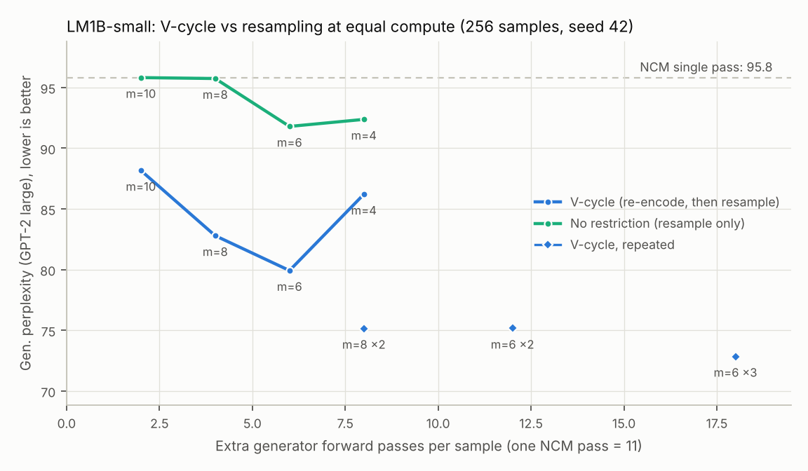
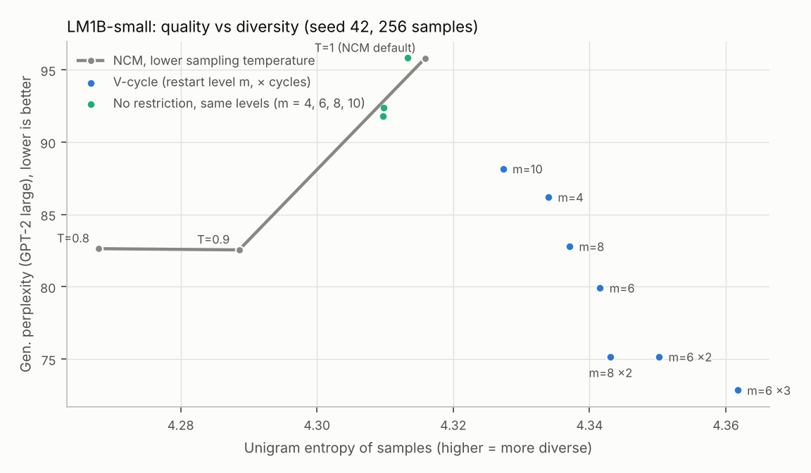
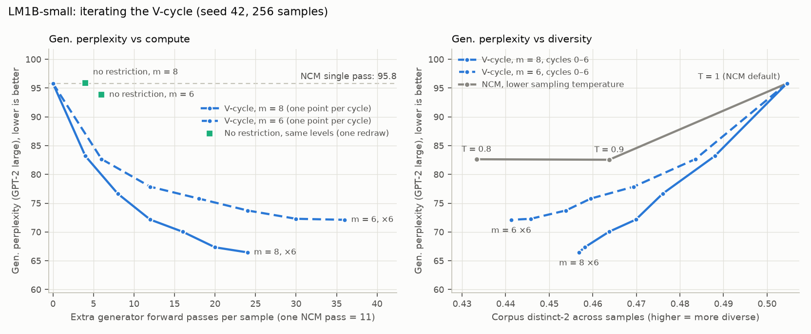
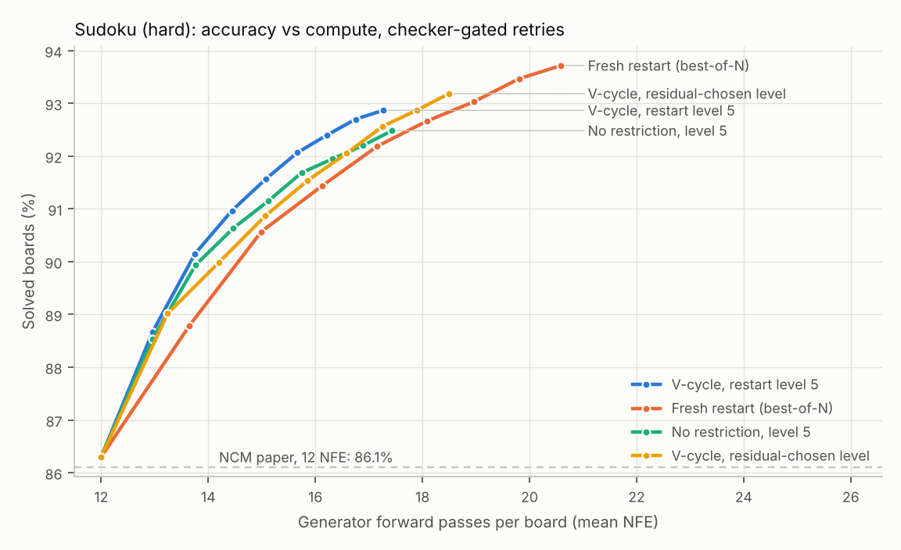

# Multigrid V-cycle decoding for Next-Concept Models (training-free)

This repo tests whether samples from **Next-Concept Modeling** (NCM; Kumbong, Khare et al.,
[arXiv:2610.14162](https://arxiv.org/abs/2610.14162), code at
[HazyResearch/ncm](https://github.com/HazyResearch/ncm)) improve when inference adds
multigrid-style correction cycles. The released checkpoints are used unchanged; nothing is retrained.

NCM decodes once, coarse to fine. A V-cycle adds the missing "restriction" step:

1. Re-encode the decoded output with the frozen tokenizer encoder.
2. Compare the re-encoded codes with the generated ones, level by level. This difference is the *residual*.
3. Keep the re-encoded coarse levels and resample the finer ones, then repeat.

The full research plan and the lab notebook are in [`PLAN.md`](PLAN.md). The prior-art check is in
[`docs/prior_art.md`](docs/prior_art.md).

## Results

| | Result |
|---|---|
| **Text: every released LM1B model** | One V-cycle from level 6 (+6 NFE) lowers generative perplexity on all three sizes: small 93.8 → **79.9**, medium 88.8 → **68.6** (20 seeds), large 82.2 → **63.9** (3 seeds × 256 samples for small and large). Resampling the same levels *without* re-encoding costs the same and gives 93.2 / 88.4 / 79.8, so the re-encode step is what matters (paired ratios **0.857 / 0.776 / 0.801**, all CIs well below 1; better on 20 of 20 medium seeds). Medium plus one V-cycle (+55% compute) beats the 2.3× larger model's single pass (68.6 vs 82.2). |
| **Text: a second dataset** | TinyStories (3 seeds × 256, the paper's genppl protocol): 16.4 → **13.3**, against 16.5 without re-encoding (ratio **0.809** [0.797, 0.821]). Entropy and per-sample diversity are unchanged. |
| **Not a GPT-2 artifact** | On LM1B-medium (20 seeds, 5,120 samples per variant): a scorer from another model family (Qwen2.5-1.5B) shows a larger gain (ratio **0.724** [0.717, 0.730]); MAUVE against 5,120 human passages rises 0.31 → **0.41** while the control stays at 0.31 (paired half-size subsamples: +0.077 [+0.024, +0.130], ahead in 20 of 20 rounds); and a local LLM judge (Qwen2.5-7B-Instruct, both orders) prefers the V-cycle text in **64%** of pairs against no restriction and **76%** against the single pass (it prefers human text over NCM in 97%). One cycle stays above human-text perplexity (68.6 vs 53.5): it repairs without over-smoothing. |
| **Prompted tasks: a small polish** | Greedy decoding as released, so no restriction reproduces the single pass exactly and the single pass is the control. **WMT14** (3,003 sentences): +0.3 to +0.55 BLEU from coarse and middle restarts (21.73 → 22.28 after three cycles from level 3); the paper's classifier-free guidance gets +1.3 BLEU for less than half that compute (+11 vs +24 NFE). **XSum** (11,334 articles): ROUGE-1/2/L +0.24 / +0.25 / +0.19 and GPT-2 perplexity −24% after three cycles from level 5; up to 47% of summaries become exact fixed points. The LLM judge calls both a near-tie (mean preference 0.515 and 0.526). Re-encoding must use the canonical output (text, EOS, PAD): the raw ids cost −4.3 BLEU. |
| **Iterating** | Restarting from level 8 converges like a multigrid cycle: the coarse residual contracts every cycle and medium reaches 65.1 after six cycles, keeping 73% of the draft, with corpus diversity down 6%. Restarting from level 6 keeps drifting: after six cycles the text is unrelated to the draft, diversity is down 13%, and medium's perplexity (51.9) falls *below* human text's (53.5). One cycle is the safe default. |
| **Residual = free error detector** | NCM samples are **never** fixed points of the tokenizer round trip (0% of 6,000 Sudoku boards, the LM1B and TinyStories texts, and 14,337 XSum and WMT14 outputs). The *amount* of disagreement flags wrong Sudoku boards with AUROC **0.92** on hard, beating the decoder's own confidence (0.87), and the worst-perplexity tenth of texts with AUROC 0.63–0.74 on LM1B and **0.81** on TinyStories. On the prompted tasks it barely flags the worst outputs (AUROC 0.51–0.63). As a compute gate on text it helps little: the V-cycle improves nearly every sample. |
| **Reproduction** | Sudoku: 99.4 / 96.4 / **86.3%** solved on easy / medium / hard (paper, hard: 86.1%). LM1B-small: gen. PPL 95.8 / 94.6 / 91.0 over three seeds, H = 4.32 (paper's NCM point: about 92, H = 4.31). |
| **Sudoku correction** | With the Sudoku checker deciding which boards to retry, V-cycle retries from level 5 beat fresh resampling (best-of-N) by **+1.2 points** at equal compute (90.4% vs 89.3% at 14 NFE; 95% CI [+0.6, +1.7]; 3 seeds × 2,000 hard boards). Most of the gain comes from keeping the coarse levels. Here the re-encode step adds only +0.3 to +0.5 points, with a CI that includes 0. |

### 1. Text: the V-cycle repairs NCM samples, and the repair comes from the restriction step

**Setup** (`experiments/lm1b_diagnostic.py`, `experiments/lm1b_sweep.py`):
- Samples are drawn exactly as NCM's own evaluation does it. Level 0 comes from the released unigram, the levels are sampled at T = 1, and tokens are picked with the released frequency and adjacency penalties (LM1B; TinyStories has none). Our decoder reproduces `generate()` code for code under the same seed, on CPU and GPU, for every model used here.
- Scoring follows the paper: corpus perplexity under GPT-2 large, with the FLM protocol for LM1B and the genppl protocol (samples cut at the first EOS) for TinyStories.
- **V-cycle:** re-encode the sample, keep the encoder's codes for levels < m, and resample levels m..11 at T = 1.
- **No restriction:** keep the *generated* codes for levels < m and resample the same levels. It costs the same.

| Variant (LM1B-small, 3 seeds × 256) | Extra NFE | Gen. PPL ↓ (per seed) | Mean | Entropy ↑ | Adjacent repeats |
|---|---|---|---|---|---|
| NCM single pass | 0 | 94.6, 91.0, 95.8 | 93.8 | 4.317 | 0.47% |
| No restriction, m = 6 | +6 | 94.7, 91.1, 93.8 | 93.2 | 4.314 | 0.45% |
| **V-cycle, m = 6** | **+6** | **80.7, 78.9, 79.9** | **79.9** | **4.344** | 0.45% |
| V-cycle, m = 3 | +9 | 95.0, 88.9, 94.2 | 92.7 | 4.324 | 0.57% |

Paired bootstrap over the 768 samples: V-cycle (m = 6) / no restriction = **0.857 [0.839, 0.876]**; V-cycle / single pass = 0.852 [0.836, 0.868]. Restarting from level 3 has no significant effect (0.985 [0.950, 1.020]).

**The effect holds at every model size and on a second dataset** (256 samples per seed: 20 seeds for LM1B-medium, 3 for the others; ratios are paired bootstraps over the pooled samples):

| Model | Single pass | No restriction, m = 6 | **V-cycle, m = 6** | V-cycle / no restriction, m = 6 | V-cycle, m = 8 (ratio) | Corpus distinct-2, single pass → V-cycle m = 6 |
|---|---|---|---|---|---|---|
| LM1B-small | 93.8 | 93.2 | **79.9** | **0.857** [0.839, 0.876] | – | 0.505 → 0.477 (seed 42) |
| LM1B-medium (317M; 20 seeds) | 88.8 | 88.4 | **68.6** | **0.776** [0.769, 0.783] | 76.8 (0.866 [0.861, 0.871]) | 0.578 → 0.545 |
| LM1B-large | 82.2 | 79.8 | **63.9** | **0.801** [0.784, 0.818] | 72.5 (0.888 [0.874, 0.901]) | 0.582 → 0.555 |
| TinyStories | 16.4 | 16.5 | **13.3** | **0.809** [0.797, 0.821] | 15.0 (0.915 [0.905, 0.924]) | 0.329 → 0.317 |

Entropy is unchanged or slightly higher in every row (`results/SUMMARY.md`).



The sweep below covers seed 42, restart levels m = 4, 6, 8 and 10, and repeated cycles:
- **Every restart level helps.** The V-cycle beats no restriction at all four levels, with ratios 0.93, 0.87, 0.87 and 0.92.
- **Repeating helps further.** Two cycles from level 8 (+8 NFE) give 75.2 (0.785 × no restriction). Three cycles from level 6 give 72.8.
- **It beats colder sampling.** Lowering NCM's sampling temperature also reduces perplexity (T = 0.9: 82.5), but it loses diversity: entropy falls to 4.289, corpus distinct-2 to 0.464 and adjacent repeats rise to 0.61%. At the same perplexity (82.8, from level 8), the V-cycle has entropy 4.337, distinct-2 0.489 and 0.35% repeats. Its points lie beyond NCM's own temperature frontier, and colder sampling cannot go lower: T = 0.8 gives 82.6.



**Is lower perplexity better text?** (`experiments/lm1b_quality.py`, `experiments/lm1b_mauve.py`, `experiments/judge.py`; LM1B-medium, 20 seeds, 5,120 samples per variant.) Four checks that do not rely on GPT-2 perplexity:

| Text | GPT-2 gen. PPL | Qwen2.5-1.5B gen. PPL | Qwen ratio vs no restriction | MAUVE vs human text ↑ (5,120 vs 5,120) |
|---|---|---|---|---|
| Human (held-out LM1B validation) | 53.5 | 40.8 | – | – |
| NCM single pass | 88.8 | 105.9 | – | 0.312 |
| No restriction, m = 6 | 88.4 | 105.6 | – | 0.307 |
| **V-cycle, m = 6** | **68.6** | **76.4** | **0.724** [0.717, 0.730] | **0.410** |
| No restriction, m = 8 | 88.7 | 106.0 | – | – |
| **V-cycle, m = 8** | **76.8** | **88.8** | **0.837** [0.832, 0.843] | – |

| LLM judge (Qwen2.5-7B-Instruct, on the GPU box; both orders) | Pairs | Mean preference for A [95% CI] | Share of pairs preferring A |
|---|---|---|---|
| Sanity check: human text (A) vs NCM single pass | 5,120 | 0.669 [0.664, 0.674] | 97% |
| **V-cycle m = 6 (A) vs no restriction m = 6** | 5,120 | **0.589** [0.581, 0.597] | **64%** |
| **V-cycle m = 6 (A) vs single pass** (the same draft) | 5,120 | **0.633** [0.626, 0.639] | **76%** |

- **A second scorer agrees, more strongly.** Qwen2.5-1.5B is a different model family with a different tokenizer.
- **MAUVE agrees, and at 5,120 samples it is significant.** The V-cycle leads no restriction by +0.10 on the full sets. Across 20 rounds of paired half-size subsamples the lead is +0.077 [+0.024, +0.130], positive in every round; no restriction does not move MAUVE at all. With 768 samples the same comparison was not resolvable (+0.06 [−0.10, +0.19]). Bootstrapping *with* replacement is not usable for MAUVE: duplicated points bias it down. Absolute MAUVE falls with the number of samples (more clusters), so only differences compare.
- **A reader-style judge agrees.** It prefers the V-cycle text over equal-compute resampling in 64% of pairs, and over the unchanged draft in 76%. Its sanity check passes (human text over NCM in 97%). The judge has a strong position bias, in a different direction per task (it picks the second text in 56–82% of LM1B pairs and the first in 72–80% of XSum and WMT14 pairs), which averaging over both orders removes; single verdicts are noisy, the averages over thousands of pairs are not.
- **No over-smoothing after one cycle.** Human text scores 53.5; one V-cycle brings NCM from 88.8 to 68.6, still well above it, closing about half (51%) of the log-perplexity gap. Human text is also far more varied across samples (corpus distinct-2 0.718 per 256 chunks, against about 0.58 for NCM), and here the V-cycle moves the wrong way (0.545).

**Iterating** (`experiments/lm1b_converge.py`; seed 42, 256 samples, six cycles):

| | Gen. PPL, cycle 0 → 1 → 3 → 6 | Corpus distinct-2, cycle 0 → 6 | Token agreement with the draft / with the previous cycle, after 6 cycles | Kept-level round-trip disagreement, cycle 0 → 1 → 6 |
|---|---|---|---|---|
| small, m = 6 | 95.8 → 82.7 → 75.8 → 72.1 | 0.505 → 0.441 | 0.14 / 0.49 | 0.94 → 0.69 → 0.55 |
| small, m = 8 | 95.8 → 83.2 → 72.1 → 66.4 | 0.505 → 0.457 | 0.55 / 0.89 | 0.90 → 0.43 → 0.24 |
| medium, m = 6 | 90.7 → 70.1 → 58.7 → 51.9 | 0.586 → 0.510 | 0.27 / 0.70 | 0.87 → 0.55 → 0.38 |
| medium, m = 8 | 90.7 → 78.5 → 70.0 → 65.1 | 0.586 → 0.552 | 0.73 / 0.95 | 0.84 → 0.28 → 0.12 |

- **No exact fixed point, but the residual contracts.** No sample ever round-trips exactly, yet the disagreement on the kept levels shrinks every cycle toward a floor, as a multigrid iteration would.
- **The restart level decides the regime.** From level 8 the chain settles: successive cycles agree on 95% of tokens, most of the draft survives, and diversity drops 6%. From level 6 it keeps moving: after six cycles the text shares little more with the draft than the no-restriction control does (0.27 vs 0.21 on medium), diversity drops 13%, and perplexity ends below human text's.
- **At equal diversity it still beats temperature.** At corpus distinct-2 0.464, four cycles from level 8 reach 70.0; NCM at T = 0.9 gets 82.5.



**Why it works.** The generator's codes are mostly not the codes the encoder would produce for the same text: 86–100% of positions at levels 0–6 disagree on LM1B-small, and 28–35% at the finest level (round trip; all three sizes). The decoder still reads them; its released config trains it with heavy code corruption, which is a likely reason. But the generator conditions its fine levels on these off-manifold coarse codes.
- **Re-encoding** puts the coarse levels back on the encoder's manifold before the fine levels are regenerated. This works as a training-free fix for exposure bias.
- **Restarting from level 3 doesn't help,** because it regenerates levels 3–5 off-manifold again.
- **The examples show an editing pass** (`results/SUMMARY.md`). The V-cycle keeps the draft's content and repairs local fluency.
  - On LM1B, *"included the students at least 30, 000 in more than five years"* becomes *"the students lost at least 30, 000 or more than five years"*. Resampling from the *generated* coarse codes produces an unrelated text instead.
  - On TinyStories, *"Once upon a time there made a little girl … so sad and and scared … said "ooIs?""* becomes *"… there was a little girl … so sad and scared … said "What happened?""*.
  - Edits are not always consistent: in another story the V-cycle turns "a thin bug named Tim" into "a thin cat" while his friend stays "Sam the bug".

**Residual-gated cycles** (`results/SUMMARY.md`; computed from the same samples). Cycling only the samples with the highest level-local residual beats a random choice at equal compute, but only by 1.5–2% perplexity on LM1B-small and TinyStories, and not significantly on LM1B-medium. Even a gate on each sample's true perplexity captures under half of the gain at q = 0.2. Gating is also no better than restarting every sample from a finer level for the same compute. On text, the V-cycle helps almost every sample.

**Caveats.**
- Cross-sample diversity drops: corpus distinct-2 falls about 4–6% after one cycle, and more with iteration from level 6. That is less than colder sampling costs, but it moves away from human text, which is more varied than NCM's samples to begin with.
- Coverage is two unconditional datasets (LM1B at three sizes, TinyStories) and two prompted tasks (section 4). OpenWebText has no released checkpoint yet.
- There is no human evaluation. Quality evidence is two perplexity scorers, MAUVE and one 7B LLM judge with a strong position bias.

### 2. The round-trip residual is a training-free error detector

A sample is a *fixed point* if `encode(decode(r)) == r`. The plan's yes/no test carries no signal, because **no NCM sample is a fixed point**. Yet `decode(encode(x)) == x` holds for every Sudoku board: the generator writes a non-canonical code for the board it means. The *amount* of disagreement does carry signal, especially the **level-local** version. At each level it asks which code the quantizer would pick given the *generated* coarser levels, so one miss does not cascade.

| Sudoku (2,000 boards each) | Solved | Residual AUROC, level-local (round trip) | Decoder confidence | Generator confidence |
|---|---|---|---|---|
| easy | 99.4% | **0.872** (0.797) | 0.848 | 0.701 |
| medium | 96.4% | **0.883** (0.867) | 0.847 | 0.627 |
| hard | 86.3% | **0.920** (0.859) | 0.875 | 0.730 |

**The residual also localizes errors** (`results/phase1b_localization_hard.json`). At level 4 (9 positions, about one board row each), the generator is 100% confident on every board. Yet when the residual fires, the covered span contains a wrong cell **97.5%** of the time (base rate 43%). Clean spans almost never fire (0.5%).

### 3. Sudoku: correction cycles help a little, mostly by keeping the coarse levels

**Setup** (`experiments/phase3_controls.py`):
- Every method starts from NCM's greedy pass, which costs 12 NFE and solves 86.3%.
- The Sudoku checker accepts a board if it is a valid grid that keeps every clue. It never sees the solution. Boards it rejects get up to 8 retry rounds at T = 1.
- Methods are compared when their *mean* compute per board reaches the same budget.
- The 95% intervals are paired bootstraps over boards, pooled over 3 seeds.

| Accuracy at a compute budget (hard, 2,000 boards × 3 seeds) | 13 NFE | 14 NFE | 15 NFE | 16 NFE |
|---|---|---|---|---|
| Fresh restart (best-of-N with the checker) | 87.8 | 89.3 | 90.6 | 91.3 |
| No restriction, level 5 (keep generated `r_{<5}`) | 88.6 | 90.2 | 91.0 | 91.8 |
| **V-cycle, level 5** (keep re-encoded `r'_{<5}`) | **88.7** | **90.4** | **91.5** | **92.3** |
| V-cycle, level chosen by the residual (V1-accept) | 88.5 | 89.8 | 90.8 | 91.6 |
| V2: masked resample at level 5 | 88.1 | 89.3 | 90.1 | 90.7 |

| Paired difference, percentage points [95% CI] | 13 NFE | 14 NFE | 15 NFE | 16 NFE |
|---|---|---|---|---|
| V-cycle (level 5) − fresh restart | +0.93 [+0.51, +1.33] | +1.19 [+0.62, +1.73] | +0.93 [+0.33, +1.56] | +0.92 [+0.32, +1.48] |
| V-cycle (level 5) − no restriction (level 5) | +0.14 [−0.16, +0.43] | +0.27 [−0.20, +0.71] | +0.45 [−0.09, +0.93] | +0.47 [−0.09, +1.01] |
| V-cycle (level 7) − no restriction (level 7) | +0.56 [+0.16, +0.99] | +0.67 [+0.20, +1.21] | +0.57 [+0.07, +1.12] | +0.68 [+0.14, +1.19] |
| V2 masked (level 5) − V-cycle (level 5) | −0.66 [−0.94, −0.38] | −1.14 [−1.55, −0.70] | −1.39 [−1.84, −0.93] | −1.54 [−2.04, −1.06] |



- **Partial restarts beat best-of-N.** Restarting from level 5 instead of from scratch is worth about +1 point at equal compute.
- **On Sudoku, the restriction step adds only a little.** It gives +0.3 to +0.5 points at level 5, with an interval that includes 0. At level 7 it is a significant +0.6, but level 7 is a poor restart point overall. This fits the LM1B mechanism: Sudoku's generated codes are mostly *on* the encoder's manifold (0–20% disagreement per level on solved boards). So re-encoding changes much less than on text, where 86–100% of coarse codes are off-manifold.
- **Masked resampling (V2) hurts.** Resampling only the disagreeing positions at the restart level is significantly worse than resampling the whole level.
- **The residual-chosen restart level (V1-accept) is competitive** but does not beat the best fixed level.
- **Greedy V-cycles** (Phase 2: temperature 0, no checker, 1,000 hard boards, baseline 84.3%) move little.
  - The plan's V1 at τ ≤ 0.1 changes nothing, and neither does the no-restriction control. Both were predicted.
  - Restarting from level 6 fixes 10 boards and breaks none in one cycle (85.3%, +6 NFE), reaching 85.5% after three.
  - Cycling only the 20% of boards with the highest residual keeps most of the gain (85.1%) at a fifth of the compute, with no checker at all.
  - With a checker available, stochastic retries (table above) are far stronger.

### 4. Prompted tasks (XSum, WMT14): a small polish

**Setup** (`experiments/cond_vcycle.py`):
- Sampling and metrics are exactly those of NCM's evaluation scripts: the source is the prompt, the levels are decoded **greedily** (both released configs set `top_k: 1`), and outputs are scored with ROUGE-1/2/L plus GPT-2 perplexity (XSum) or sacreBLEU and chrF (WMT14). Our decoder matches `generate()` code for code on both (64 test prompts each), with and without a new pad-aware prompt cache.
- Under greedy decoding, regenerating from the *generated* coarse codes reproduces the single pass exactly (checked: 100% of documents), so the single pass is the equal-compute control.
- **The restriction re-encodes the output in canonical form: text, EOS, then PAD.** After the first EOS the picked ids are decoder noise. In a round-trip test on 48 outputs, the frozen tokenizer reproduces 92% of WMT14 outputs exactly from the canonical form and 40% from the raw ids. On WMT14, re-encoding the raw ids costs −4.28 BLEU [−4.77, −3.81] and makes translations 12% longer (length ratio 0.94 → 1.05). On XSum, where the round trip is 79% for both forms, it costs little (one cycle: R-2 +0.13 instead of +0.18), as the test predicted.

| WMT14 de→en, 3,003 sentences (single pass BLEU 21.73) | Δ BLEU after 1 / 2 / 3 cycles [95% CI] | Sentences fixed after 3 cycles |
|---|---|---|
| Restart from level 3 (+8 NFE per cycle) | +0.32 [+0.05, +0.59] / +0.49 [+0.21, +0.77] / **+0.55** [+0.25, +0.83] | 33% |
| Restart from level 5 (+6) | +0.29 [+0.10, +0.50] / +0.23 [+0.02, +0.45] / +0.27 [+0.05, +0.51] | 41% |
| Restart from level 7 (+4) | −0.09 [−0.21, +0.01] / −0.04 / −0.09 (sentence chrF significantly lower) | 74% |

| XSum, 11,334 articles (single pass R-1/R-2/R-L 34.92/12.71/27.93, GPT-2 PPL 82.6) | Δ R-1 / R-2 / R-L after 3 cycles [all CIs above 0] | GPT-2 PPL | Summaries fixed after 3 cycles |
|---|---|---|---|
| Restart from level 5 (+4 NFE per cycle) | **+0.24 / +0.25 / +0.19** (one cycle: +0.19 / +0.18 / +0.15) | 62.5 (×0.76; one cycle ×0.83) | 47% |
| Restart from level 3 (+6) | +0.13 / +0.20 / +0.11 | 64.1 (×0.78) | 22% |

- **Content kept, fluency polished.** Summary length is unchanged (20.7 words) and the reference scores rise slightly, while perplexity falls about as much as on free-running text.
- **The iteration converges here.** Greedy decoding makes a cycle a deterministic map, so outputs can reach exact fixed points: 47% of XSum summaries are unchanged by the third cycle from level 5. On free-running text, where the levels are sampled, the gains shrink per cycle instead.
- **Readers barely notice.** The LLM judge calls both tasks a near-tie for one cycle from level 5: mean preference for the V-cycle 0.526 [0.516, 0.535] on 2,000 XSum articles and 0.515 [0.506, 0.525] on all WMT14 sentences, while the share of single pairs preferring it is 44% on both.
- **Other levers are bigger.** On WMT14, the paper's own classifier-free guidance gives +1.3 BLEU for +11 NFE (its Table 2, lowercased BLEU), more than the V-cycle's +0.56 lowercased (+0.55 cased) for +24 NFE.
- **The residual is no error detector here** (worst-decile AUROC 0.51–0.53 on WMT14, 0.60–0.63 on XSum): when the prompt fixes the content, a bad output is mostly a wrong content choice.

### What changed from the plan

- **V1 as written is a guaranteed no-op under greedy decoding.** With τ = 0, the levels below j agree, so the same context resamples the same codes. We added *V1-accept*, which also keeps the re-encoded level j.
- **V3 clue projection rarely changes anything.** The greedy model overwrites a clue on only 0.1% of hard boards.
- **The yes/no fixed-point criterion is replaced by graded residuals.**
- **Prior art:** DiverseVAR's "scale-travel" (arXiv:2511.21415) already re-encodes with a multiscale tokenizer and resumes generation at a fixed scale, once, for images. The residual-chosen restart level, the iteration, the controls and the text setting are what is new here. Details are in [`docs/prior_art.md`](docs/prior_art.md).

### Suggested next steps

- **Human preference check** on free-running text, V-cycle vs equal-compute resampling: the LLM judge's 64% is the weakest link in the quality evidence.
- **Classifier-free guidance plus a V-cycle** on WMT14 and XSum, and minimum-Bayes-risk decoding at equal compute: are the gains additive, or does CFG already capture them?
- **Choosing when to stop iterating:** restarting from a finer level converges and from a coarse one drifts on free-running text; a stopping rule based on the contraction of the coarse residual is untested.
- **OpenWebText**, once its checkpoint is released (it needs `query_level0: false`, which `LevelDecoder` supports).
- **Training-side follow-up for the NCM authors:** teacher-force on the generator's own re-encoded codes, so its coarse levels land on the encoder's manifold in the first place.

## How the pieces map

| Multigrid | NCM | Code |
|---|---|---|
| Coarse grid | code levels k = 0..K-1 (Sudoku: lengths 1, 2, 4, 6, 9, 13, 18, 26, 37, 50, 67, 89) | `LevelDecoder.levels` |
| Prolongation | generate levels k+1..K-1 given `ẑ^(k)` | `LevelDecoder.run(prefix, start=j, codes=...)` |
| Restriction | re-encode tokens with the frozen encoder + quantizer | `LevelDecoder.encode` |
| Residual | per-level disagreement between `r_k` and the re-encoded `r'_k` | `vcycle.vcycle.disagreement` |
| Level-local residual | at each level, the code the quantizer would pick given the *generated* coarser levels, so a miss does not cascade | `LevelDecoder.encode_given_coarse` |
| V-cycle | decode → re-encode → keep `r'_{<m}` → resample m..K-1 → decode | `vcycle.vcycle.cycle` |

## Reproducing

```bash
./setup.sh                          # NCM code (pinned), Sudoku checkpoints and boards
experiments/run_sudoku.sh           # Phases 0, 1, 1b, 2, 3 on Sudoku, one job at a time
hf download hazyresearch/ncm-checkpoints lm1b/tokenizer.pt lm1b/small/generator.pt lm1b/small/config.yaml --local-dir artifacts
experiments/run_lm1b.sh small       # LM1B: 3 seeds, residual diagnostic + V-cycle vs no restriction
experiments/run_lm1b.sh medium "42 0 1" "6,8"   # also large; checkpoints lm1b/<size>/generator.pt and config.yaml
python experiments/lm1b_sweep.py --size small --seed 42   # restart levels, repeated cycles, lower temperatures
python experiments/lm1b_converge.py --size medium --seed 42 --cycles 6:6,8:6   # iterated V-cycles, resumable
python experiments/lm1b_diagnostic.py --task tinystories --n 256 --seed 42 --vcycle 6,8   # checkpoint tinystories/*
hf download hazyresearch/ncm-datasets --repo-type dataset lm1b/valid_bert_30522.bin lm1b/valid_bert_30522_offsets.npy --local-dir data
python experiments/lm1b_quality.py --size medium --variants "baseline,vcycle|m=6,no-restrict|m=6,vcycle|m=8,no-restrict|m=8"
python experiments/lm1b_mauve.py --size medium --boot 20   # MAUVE with paired half-size subsampling
hf download hazyresearch/ncm-checkpoints xsum/generator.pt xsum/tokenizer.pt xsum/config.yaml wmt14/generator.pt wmt14/tokenizer.pt wmt14/config.yaml --local-dir artifacts
python experiments/cond_vcycle.py --task xsum --levels 3,5 --cycles 3     # also --task wmt14 --levels 3,5,7; --raw_restrict for the ablation
python experiments/judge.py --task lm1b --size medium --a "vcycle|m=6" --b "no-restrict|m=6"   # needs a >= 16 GB GPU
bash experiments/box/queue.sh                                             # everything above, resumable, on a rented GPU (see experiments/box/)
python experiments/analyze.py       # writes results/SUMMARY.md, results/summary.json and the charts
```

- **Scoring model:** LM1B scoring downloads GPT-2 large (about 3 GB) on first use.
- **Interruptions:** Phase 2, Phase 3 and `lm1b_diagnostic.py` checkpoint and resume after one.
- **Full tables** (every variant, every budget, the LM1B examples) are in [`results/SUMMARY.md`](results/SUMMARY.md). Raw numbers are in `results/*.json`.

- **CPU and GPU.** The Sudoku results and the LM1B-small, LM1B-medium seed 42 and sweep results were produced on 4 CPU cores; everything else on one 6 GB laptop GPU (RTX 4050). `vcycle.common.device()` picks CUDA when it is available. GPU scoring reproduces the CPU per-sample NLL to 4e-7, so seeds from both can be pooled, but the same seed gives different samples (CUDA RNG). One LM1B-medium seed takes about 6 minutes on the GPU and 43 on the CPU.
- **Small GPUs.** `LM1B.nll` parks the generator on the CPU while GPT-2 large scores (automatic below 16 GB). Without it, Windows silently spills to system memory.
- **GPU equivalence caveat.** On GPU, the cached-prompt Sudoku decoder differs from `generate()` on 1 of 2,000 boards, at a near-tie (logit margin 3e-6), so `phase0_baseline.py`'s exact assert fails there; the uncached decoder matches on all 2,000.
- **Checkpoints** are loaded with `torch.load(weights_only=True)`.

| Path | What it is |
|---|---|
| `vcycle/loading.py` | builds the tokenizer and generator from a released checkpoint directory |
| `vcycle/decoding.py` | `LevelDecoder`: level-by-level sampling, start mid-hierarchy, masked resampling, cached prompt keys/values, encode/decode. It is checked to match `NextConceptTransformer.generate` code for code |
| `vcycle/vcycle.py` | restart-level rules (V1/V4 and V1-accept), masked V2, constraint projection (V3), iterated cycles |
| `vcycle/sudoku.py` | board format, clue projection, metrics (solved, valid, unit and clue violations) |
| `experiments/phase*.py` | one script per phase of the plan; outputs go to `results/*.json` |
| `vcycle/lm1b.py` | unconditional text (LM1B, TinyStories): sampling exactly as the released eval does it, the config's scoring protocol (FLM or genppl), diversity metrics |
| `experiments/lm1b_diagnostic.py` | residual diagnostic, plus V-cycle vs no-restriction at equal compute (`--task tinystories` for TinyStories) |
| `experiments/lm1b_sweep.py` | restart levels, repeated cycles, lower-temperature baselines |
| `experiments/lm1b_converge.py` | iterated V-cycles: quality, diversity, residual contraction and drift after every cycle |
| `experiments/lm1b_quality.py` | human-text anchor, second-scorer perplexity, MAUVE |
| `experiments/lm1b_mauve.py` | MAUVE with uncertainty from paired half-size subsampling |
| `vcycle/cond.py`, `experiments/cond_vcycle.py` | prompted tasks (XSum, WMT14): released sampling and metrics, canonical re-encoding, iterated greedy V-cycles, paired bootstraps |
| `experiments/judge.py` | pairwise LLM judge, run locally; both orders, next-token probabilities |
| `experiments/box/` | rented-GPU tooling: setup, resumable two-lane queue with a hard shutdown, judge-only scripts, SSH push and pull |
| `experiments/analyze.py` | tables, paired-bootstrap intervals and the charts |
